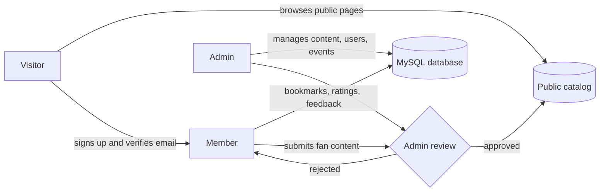
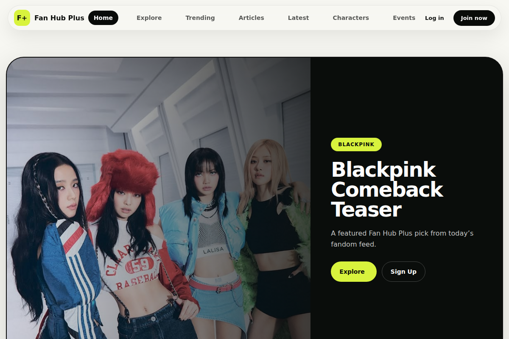
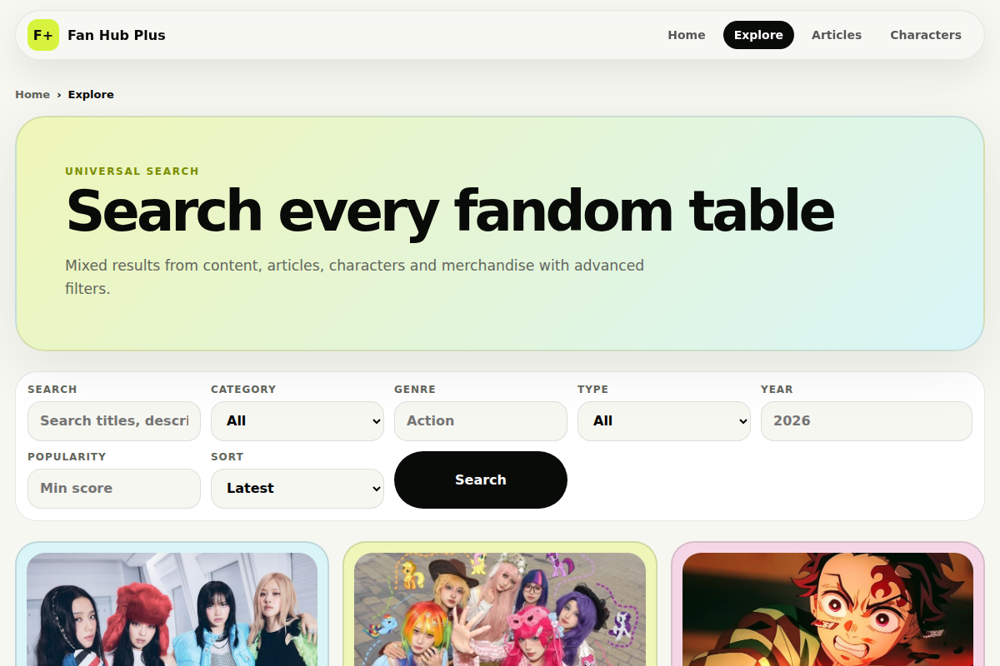
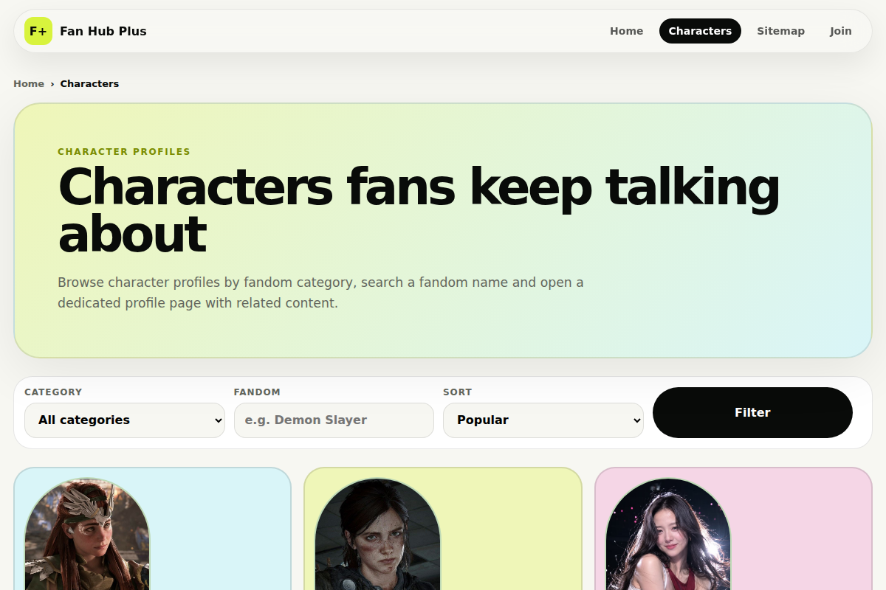
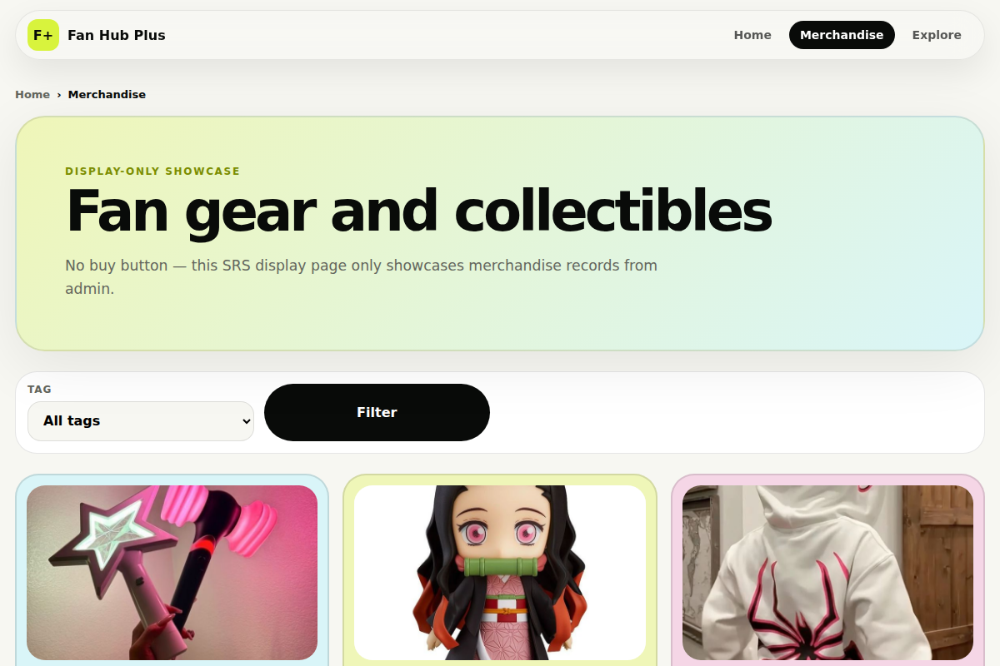
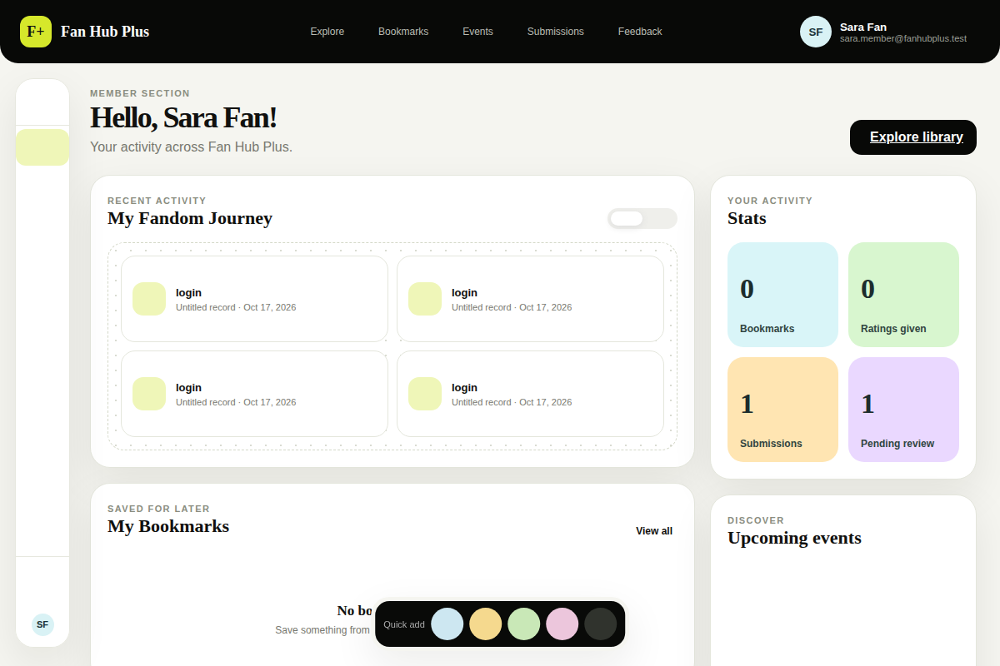
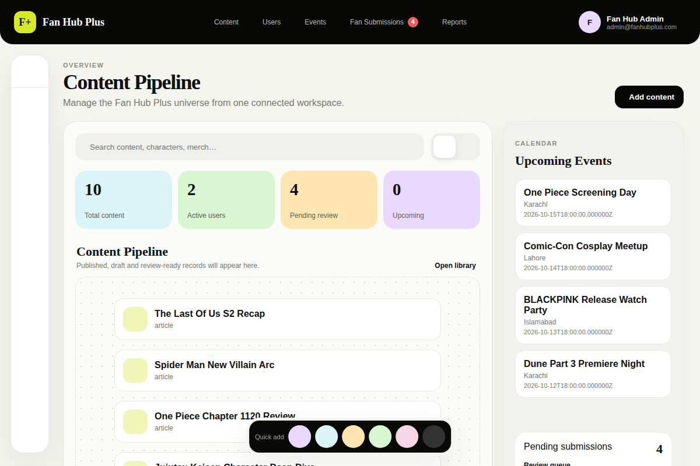
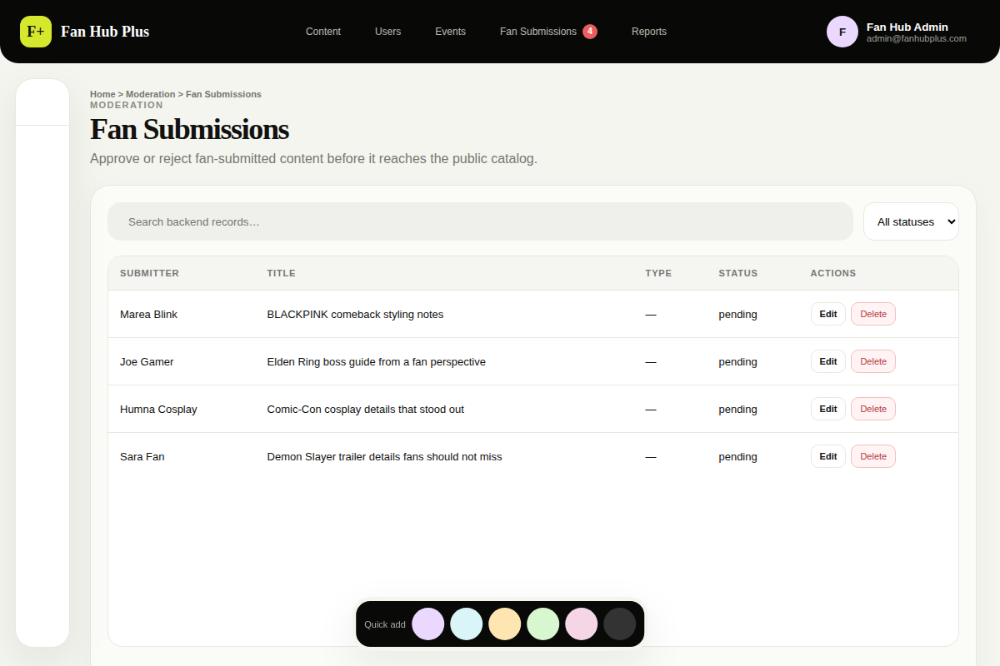

<div align="center">


<br>

### Where fans read, explore, collect and contribute.

<br>


<br>

[**Live Demo**](https://aptechmetrostargate.com:205/) &nbsp;|&nbsp; [**Demo Video**](#) &nbsp;|&nbsp; [**Features**](#features) &nbsp;|&nbsp; [**Screenshots**](#screenshots) &nbsp;|&nbsp; [**Setup**](#getting-started)

</div>

---

## About

**Fan Hub Plus** is a fandom community platform. Fans are usually scattered across social apps, wikis and forums, with no single organized home and no safe way to contribute. Fan Hub Plus brings articles, character profiles, events and merchandise together in one place, and lets members submit their own content, which admins review before it goes public.

<br>

## Features

<table>
<tr>
<td width="33%" valign="top">

### Visitors
No account needed.

- Featured articles and stories
- Character profiles
- Events with calendar and filters
- Merchandise showcase
- Search by category, fandom and tags

</td>
<td width="33%" valign="top">

### Members
Free account with verified email.

- Personal dashboard
- Bookmarks and favourite categories
- Rate media
- Send feedback
- Submit fan content and track review status
- Profile, avatar and dark mode

</td>
<td width="33%" valign="top">

### Admins
Secure management panel.

- Content pipeline and live stats
- Manage articles, characters, media and merch
- Event calendar
- Approve or reject fan submissions
- User management
- Feedback inbox and activity log

</td>
</tr>
</table>

<br>

## How it works



<br>

## Screenshots

<div align="center">


<br><sub><b>Home</b>: featured stories and category lanes</sub>

<br><br>

<table>
<tr>
<td align="center"><br><sub><b>Explore</b>: search every fandom table</sub></td>
<td align="center"><br><sub><b>Characters</b>: profiles fans talk about</sub></td>
</tr>
<tr>
<td align="center"><br><sub><b>Merchandise</b>: fan gear and collectibles</sub></td>
<td align="center"><br><sub><b>Member dashboard</b>: activity, stats, bookmarks</sub></td>
</tr>
<tr>
<td align="center"><br><sub><b>Admin dashboard</b>: content pipeline and stats</sub></td>
<td align="center"><br><sub><b>Fan submissions</b>: review queue</sub></td>
</tr>
</table>

</div>

<br>

## Tech stack

| Layer | Technology |
|:------|:-----------|
| **Backend** | Laravel 12, PHP 8.2+ |
| **Database** | MySQL / MariaDB (28 tables, 3 views) |
| **Frontend** | Blade views, HTML, CSS, JavaScript |
| **Tooling** | Composer, Vite, Tailwind CSS |
| **API docs** | Postman collections in [`docs/`](docs) |

<br>

## Security

| | |
|:--|:--|
| **Role-based access** | Separate middleware for admins, active users and verified emails |
| **Safe content** | HTML sanitizer for user-submitted content |
| **Safe links** | URL validation rule for links entered by users |
| **Passwords** | Stored hashed; admin password is set through an artisan command |

<br>

## Database

28 tables and 3 views covering users and profiles, categories, tags, content, articles (with images and timelines), character profiles, merchandise, events, media ratings, bookmarks, feedback, fan submissions and an activity log.

Views: `vw_content_bookmark_counts`, `vw_media_average_rating`, `vw_pending_fan_submissions`.

Full schema: [`database/db_fanhub.sql`](database/db_fanhub.sql) &nbsp;|&nbsp; Migrations: [`database/migrations`](database/migrations)

<br>

## Getting started

**Requirements:** PHP 8.2+, Composer, MySQL or MariaDB (XAMPP works), Node.js (optional, for Vite).

<details>
<summary><b>Click to see the setup steps</b></summary>

<br>

**1. Clone and install**
```bash
git clone https://github.com/muntaha-shafique/fanhub-master.git
cd fanhub-master
composer install
```

**2. Environment file**
```bash
cp .env.example .env          # Windows: copy .env.example .env
php artisan key:generate
```

**3. Database settings in `.env`**
```env
DB_CONNECTION=mysql
DB_HOST=127.0.0.1
DB_PORT=3306
DB_DATABASE=db_fanhub
DB_USERNAME=root
DB_PASSWORD=
```

**4. Create the database and load data** (choose one)
```bash
# Option A: import the ready-made SQL (includes demo content)
mysql -u root -e "CREATE DATABASE db_fanhub CHARACTER SET utf8mb4"
mysql -u root db_fanhub < database/db_fanhub.sql

# Option B: migrations and seeders
php artisan migrate --seed
```
With phpMyAdmin you can also import `database/db_fanhub.sql` directly.

**5. Set an admin password** (12+ characters, upper and lower case, with a number)
```bash
php artisan admin:set-password admin@fanhubplus.com
```

**6. Run**
```bash
php artisan serve
```
Open http://127.0.0.1:8000

</details>

| Area | URL |
|:-----|:----|
| Public site | `/` |
| Member login and dashboard | `/login`, `/user` |
| Admin login and dashboard | `/admin/login`, `/admin` |

<br>

## Project structure

```
fanhub-master
├── app
│   ├── Http
│   │   ├── Controllers
│   │   │   ├── Visitor      public pages
│   │   │   ├── Member       member area and APIs
│   │   │   └── Admin        admin area and APIs
│   │   └── Middleware       role, active-user, email checks
│   ├── Models               Eloquent models
│   └── Services             catalog, sanitizer, admin resources
├── database
│   ├── migrations           schema
│   └── seeders              categories, tags, demo content
├── resources/views          Blade templates
├── routes                   web, visitor, member, admin
├── docs                     backend notes + Postman collections
└── screenshots              images used in this README
```

<br>

## API documentation

| Area | Notes |
|:-----|:------|
| Visitor | [`VISITOR_BACKEND.md`](docs/VISITOR_BACKEND.md) |
| Member | [`REGISTERED_USER_BACKEND.md`](docs/REGISTERED_USER_BACKEND.md) |
| Admin | [`ADMIN_BACKEND.md`](docs/ADMIN_BACKEND.md) |
| Postman | `admin-api.postman_collection.json`, `registered-user-api.postman_collection.json` |

<br>

## Roadmap

- [x] Visitor, member and admin areas
- [x] Moderated fan submissions
- [x] Bookmarks, ratings and feedback
- [ ] Notifications
- [ ] Comment threads and discussions
- [ ] Smarter search and recommendations
- [ ] More fandoms and categories

<br>

## License

Released under the [MIT license](https://opensource.org/licenses/MIT).

<div align="center">

<br>

**Built with care for fans, by fans.**

</div>
